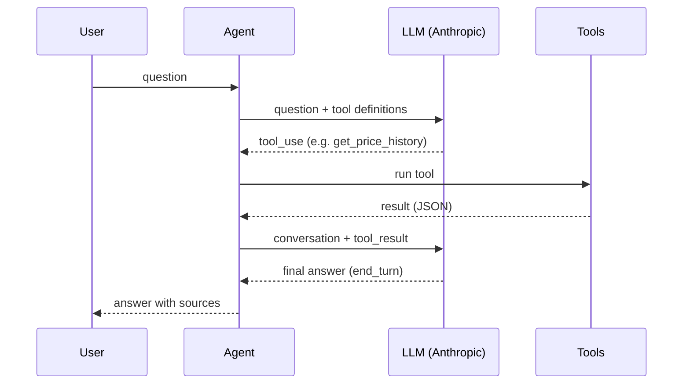

# tmyts-rust-financial-advisor

AI portfolio research assistant in Rust. It answers questions about markets and assets by combining **price history from Postgres** with **semantic search over financial news in Qdrant**, and cites its sources. It is built directly on the Anthropic Messages API, **without an agent framework**: the LLM client, the tool-calling loop and the tools are all written by hand, so every prompt, retry and token is explicit and testable.

It is the research part of a larger platform:

| Part | Role |
|---|---|
| Trading engine | Algorithmic trading app; owns prices and portfolios |
| **Advisor (this repo)** | Researches, explains risk, and later proposes portfolio changes for the user to approve |
| Monitoring | Rust/Axum app watching production in K3d |
| Angular app | Front end for users |

> The advisor is a **research assistant, not an advice engine**: it explains data and news and never tells the user to buy or sell a specific security. Portfolio changes (planned) are proposals that a person approves.

## Status

| Capability | State |
|---|---|
| Anthropic provider, timeouts, typed errors | Done |
| OpenAI provider (Responses API), switchable in config | Done |
| Provider health check: valid key and configured model exists | Done |
| Tool-calling agent loop | Done |
| `get_price_history` (Postgres) | Done |
| `search_news` (Qdrant + embeddings) | Done |
| Startup health checks (Postgres, embeddings, Qdrant) | Done |
| Prompt-injection warden for news text | Done |
| Cost tracking (tokens and USD per question, prices from config) | Done |
| Eval suite with rule-based checks and reports | Done |
| Portfolio tools (holdings, risk metrics) | Planned |
| Axum API with SSE streaming for Angular | Planned |
| Retries, rate limiting, Prometheus metrics | Planned |
| Docker image, K3d deployment | Planned |

## How a question is answered



The loop repeats until the model gives a final answer, at most `max_tool_rounds` times. A failing tool is reported back to the model (which can correct its input) instead of aborting the question. A reply cut off by `max_tokens` is reported as an error, never shown as an answer.

## Architecture

A Cargo workspace. Dependencies only point downward; `advisor-core` depends on nothing in the workspace.

```
bins/advisor-api          CLI: one question, one answer
bins/advisor-evals        eval runner: cases -> agent -> checks -> report
        |
crates/advisor-app        composition root: settings, factories, startup checks
        |
crates/advisor-agent      tool-calling loop, conversation history, run trace
        |
crates/advisor-tools      typed tools + registry: current_date, get_price_history, search_news
crates/advisor-llm        LlmProvider trait, Anthropic + OpenAI providers, TimedProvider, pricing
        |
crates/advisor-market-data   PriceRepository (Postgres, sqlx)
crates/advisor-news-rag      NewsRepository (Qdrant)
crates/advisor-embed         Embedder (HTTP embedding service)
crates/advisor-warden        prompt-injection filter for third-party text
        |
crates/advisor-core       Secret, timed(), HealthCheck
crates/advisor-observability   tracing setup
```

Planned crates (`advisor-memory`, `advisor-portfolio`) and binaries (`advisor-ingest`, `advisor-mcp`) are placeholders for now.

## Design decisions

- **No agent framework.** The provider client and agent loop are about a few hundred lines; writing them keeps prompts, retries, costs and failure handling visible.
- **Dependency injection everywhere.** The agent receives an `Arc<dyn LlmProvider>` and a `ToolRegistry`; tools receive `Arc<dyn PriceRepository>`, `Arc<dyn NewsRepository>` and `Arc<dyn Embedder>`. Only the composition root (`crates/advisor-app`, shared by every binary) names concrete types, so tests inject in-memory fakes and need no network or database.
- **Configuration, not code, selects behaviour.** The LLM provider (`[llm] provider`) and the enabled tools (`[tools] enabled`) come from the settings file. Unknown names are rejected when the file is read.
- **Wire types separate from domain types.** Each provider's JSON shapes live in a private `wire` module and convert to provider-neutral types (`ChatRequest`, `ChatResponse`, `ContentBlock`). Anthropic and the OpenAI Responses API differ a lot (messages with blocks vs. a flat list of typed items, a `stop_reason` field vs. one derived from `status` and the output, cached tokens counted in or out of the input), and all of it stays inside the adapters: the agent and tools are the same for both.
- **Provider state is carried, not interpreted.** What a provider needs back in the next request (OpenAI reasoning items, Anthropic thinking blocks) is kept as an opaque `ContentBlock::ProviderState`. Only the provider that produced it sends it back, so a conversation stays valid when the provider is switched.
- **The content decides, not the label.** The agent runs tools when the reply contains tool calls, whatever stop reason the provider reported, and never runs tools from a reply cut off by `max_tokens`.
- **Errors carry the retry decision.** Each `LlmError` says whether retrying can help. A missing model or an empty account (which OpenAI reports as HTTP 429, like a rate limit) is not retryable.
- **Typed tools.** A tool declares a Rust input struct; its JSON schema (including doc comments as descriptions) is generated with `schemars`, and the model's input is validated against it before the tool runs.
- **Decorators for cross-cutting concerns.** `TimedProvider` wraps any provider to time, limit and log every call; retries and rate limiting will be added the same way.
- **Fail fast at startup.** Every service a tool depends on is health-checked in parallel before the agent starts, including a check that the embedding size matches the Qdrant collection.
- **Untrusted text is screened.** News is written by third parties and goes straight into the model's context, which makes it a channel for indirect prompt injection. Every title and excerpt passes through `advisor-warden`: weighted pattern rules (instruction overrides, role manipulation, exfiltration attempts, fake conversation markers, hidden Unicode) produce a score; suspicious text is cleaned and flagged, likely attacks are withheld, and every detection is logged. The rules are tested against ordinary financial language to keep false positives out. It is one layer, not a guarantee: tools are also read-only and the model is told to treat news as information, never as instructions.
- **Least privilege.** The advisor reads the trading database with a read-only user (`sql/advisor_readonly_user.sql`). Secrets are wrapped in a `Secret` type that never prints its value and is zeroed on drop.
- **Cost is measured, not guessed.** Every LLM call's tokens (including prompt-cache reads and writes) are recorded in a `RunTrace` and priced per call from `[pricing.models]` in the settings file, so a price change is a config edit. A model without a price reports cost as *unknown*, never as zero. Failed questions keep their trace, because they cost money too.
- **Evals check behaviour, not wording.** `evals/cases.toml` lists questions with rules: which tools must (not) be called and with which inputs, phrases the answer must (not) contain, a cited link for news, and limits on LLM calls and cost. The checks are deterministic code; the runner uses the real agent and services and writes JSON and Markdown reports. Cases include a buy/sell-advice request and a direct prompt-injection attempt.
- **Deterministic requests.** Tool definitions are kept in a `BTreeMap`, so requests are byte-for-byte identical between runs (a prerequisite for prompt caching).

## Requirements

- Rust 1.97 or newer (edition 2024)
- Postgres with the trading app's `assets` and `assets_price_history` tables
- Qdrant with the news collection (384-dimension vectors, cosine distance)
- The embedding service that produced those vectors
- An API key for the selected provider: Anthropic (from the Claude Console; billed separately from a claude.ai plan) or OpenAI

## Setup

1. Create the read-only database user (once, as an admin), then set its password:
   ```bash
   psql -U postgres -d <database> -f sql/advisor_readonly_user.sql
   psql -U postgres -d <database> -c '\password advisor_ro'
   ```
2. Copy `.env.example` to `.env` and fill in the secrets:
   ```
   ANTHROPIC_API_KEY=sk-ant-...   # with provider = "anthropic"
   OPENAI_API_KEY=sk-...          # with provider = "openai"
   ADVISOR_CONFIG=config/advisor.toml
   POSTGRES_PASSWORD=...
   QDRANT_API_KEY=...        # only if Qdrant uses one
   ```
3. Review `config/advisor.toml`: database host/port/name/user, embedding service URL, Qdrant URL and collection, model and limits. Every setting is commented.

Secrets live only in the environment; everything else is in the versioned settings file. In K3d these map onto a Secret and a ConfigMap.

## Run

```bash
cargo run -p advisor-api -- "How did AAPL perform last month, and what was in the news?"
```

The answer goes to stdout; the log (stderr) shows the startup health checks, each tool call and each LLM call with its duration, token counts and stop reason. More detail without editing the config:

```bash
RUST_LOG=debug cargo run -p advisor-api -- "..."
```

Each answer ends with a log line with the LLM calls, tools, tokens and cost of the question:

```
INFO advisor_api: question answered llm_calls=2 tools=["price_history"] input_tokens=4030 output_tokens=912 cost_usd=$0.017380 elapsed_ms=6120
```

## Evals

```bash
cargo run -p advisor-evals                          # all cases in evals/cases.toml
cargo run -p advisor-evals -- --only price_aapl     # one case (repeat --only for more)
```

Evals call the paid API and the real Postgres and Qdrant, so they are run on demand (before a release, after a prompt or model change), not on every build. Each run prints a summary and writes `evals/reports/eval-<timestamp>.json` and `.md`. The exit code is 0 when every case passed and 1 otherwise, so a run can gate a deployment. The pipeline itself (agent, checks, report) is covered by free, deterministic tests with a scripted provider.

## Tests

```bash
cargo nextest run          # or: cargo test
```

All unit and integration tests run without network access, using fake HTTP servers (`wiremock`), scripted LLM providers and in-memory repositories. Two tests against real services are ignored by default:

```bash
# Postgres
TEST_PG_HOST=localhost TEST_PG_PORT=5432 TEST_PG_DATABASE=<db> \
TEST_PG_USERNAME=advisor_ro TEST_PG_PASSWORD=... TEST_PG_TICKER=AAPL \
cargo test -p advisor-market-data -- --ignored --nocapture

# Qdrant + embedding service
TEST_QDRANT_URL=http://localhost:6334 TEST_QDRANT_COLLECTION=<collection> \
TEST_EMBED_URL=http://<host>:<port>/<endpoint> \
cargo test -p advisor-news-rag -- --ignored --nocapture
```

## License

MIT
